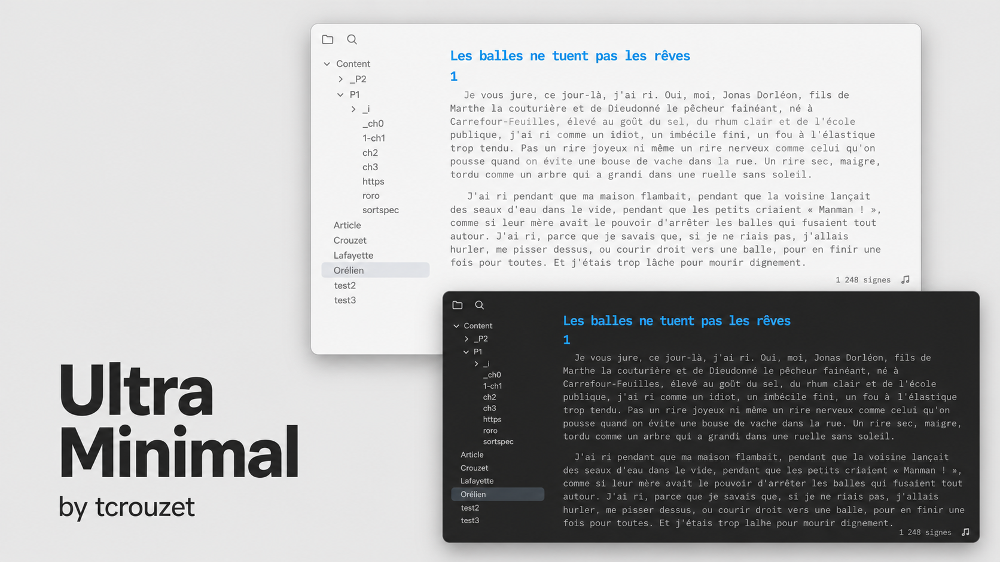
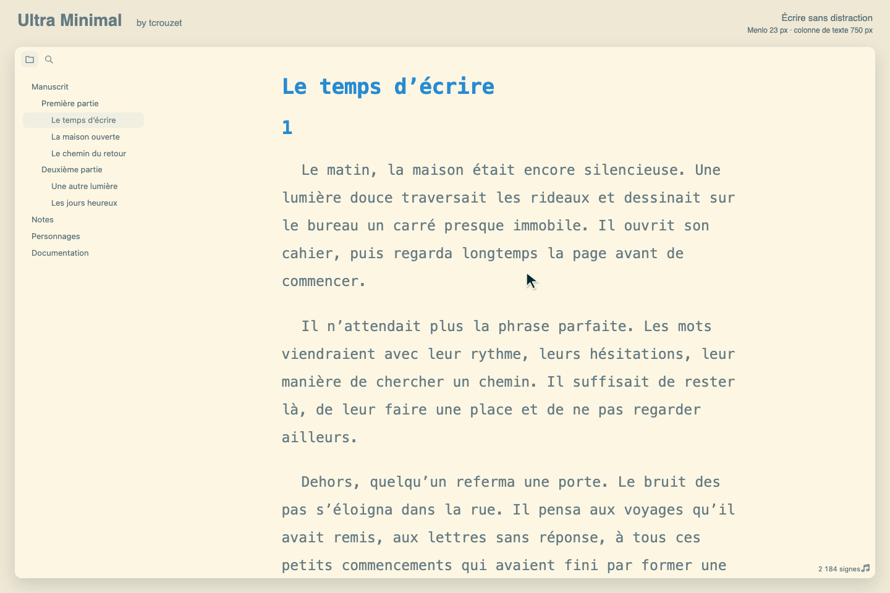

# Ultra Minimal



Minimal isn't minimal enough. Ultra Minimal turns Obsidian into a Ulysses-like writing environment for long-form texts.

Ultra Minimal is also lighter in code: about 20 KB of CSS, compared with roughly 270 KB for Minimal.

Ultra Minimal handles interface hiding itself, making a plugin such as Hider or ProZen unnecessary for a distraction-free writing workspace.

Notes use Menlo at `23px` by default, with Consolas, DejaVu Sans Mono and monospace fallbacks. The text column is limited to `750px`. The explorer and command ribbon share the editor background. Interface and code fonts follow Obsidian's settings.

## Why this palette uses base01 for text rather than base0

The palette is [Solarized](https://ethanschoonover.com/solarized/), untouched. Solarized is built as four background tones and four content tones, mirrored around the middle so that light and dark modes are exact inversions of each other: `base3`/`base2` are the light backgrounds, `base03`/`base02` the dark ones, and `base00`/`base01` are meant to carry text on a light background while `base0`/`base1` carry text on a dark one. The two halves must never be crossed. Putting `base0` on `base3`, for instance, yields a contrast ratio of 2.9:1 — technically a colour, practically invisible.

Within that constraint there are still two legitimate choices for body text, and this theme takes the stronger one. Schoonover designates `base00` as the default body tone and `base01` as the optional emphasized tone; this theme promotes the emphasized tone to default. On the light background that moves body text from **4.13:1 to 4.99:1**, and on the dark background from 4.75:1 to **5.61:1**. The gain is not cosmetic: 4.13:1 falls below [WCAG 2.2 level AA](https://www.w3.org/WAI/WCAG22/Understanding/contrast-minimum.html), which requires 4.5:1 for body text, whereas 4.99:1 clears it. Nothing else changes — no hex value is edited, the eight accent colours stay exactly as published, and the light/dark symmetry Solarized is built on remains intact.

What the research actually supports is worth stating plainly, because a lot of folklore surrounds this palette. [WCAG 2.2](https://www.w3.org/WAI/WCAG22/Understanding/contrast-enhanced.html) sets 4.5:1 as the minimum and 7:1 as the enhanced target; ISO 9241-303 asks for 3:1 minimum and recommends 10:1. Reading performance, however, saturates early: beyond roughly 10:1 no measurable gain remains, and pure black on pure white (21:1) is frequently reported as uncomfortable. The newer [APCA model](https://git.apcacontrast.com/) argues that a single ratio is a poor predictor anyway, since perceived contrast depends on font size and weight — at the 23 px default used here, legibility requirements are considerably more forgiving than for small UI text. As for eye strain, the evidence points elsewhere entirely: the [BMJ Open Ophthalmology review of digital eye strain](https://bmjophth.bmj.com/content/3/1/e000146) identifies blink rate, dry eye, viewing distance and the luminance of the screen relative to the room as the determining factors, and [controlled comparisons of light and dark polarity](https://www.nngroup.com/articles/dark-mode/) find no significant difference in measured fatigue.

So let me be clear about what Solarized is and is not. Schoonover's stated rationale is a matter of precise CIELAB relationships — symmetric lightness differences, selective contrast, a reduced brightness range — and he never claims any ophthalmological benefit. The widespread belief that Solarized reduces eye strain is a community invention, not a finding. **Solarized is an aesthetic choice before it is anything else**, and that is reason enough to use it. This theme simply makes that aesthetic choice without dropping below the accessibility floor.

This adaptation keeps Solarized’s internal logic while abandoning its warm yellow cast. The background tones are now neutral grey and off-white, but their lightness hierarchy, symmetry and contrast relationships remain unchanged; the accent colours are preserved as they are. The result is therefore not a new colour system, but a more neutral version of Solarized: less distinctive perhaps, but calmer and closer to the grey-and-white page on which I actually want to write.

## Interface visibility

The following elements stay hidden:

- The note header, including its file name, breadcrumbs, back/forward navigation and action buttons.
- The note tab bar, with no reserved space or hover detection at the top.
- The automatic file title at the top of the note. Headings written in the note remain visible.
- Scrollbars; scrolling with a mouse wheel, trackpad or keyboard still works.
- Obsidian tooltips.
- Search suggestions.
- YAML properties in Reading view; they remain available in editing views.
- The vault profile footer, including the vault name, vault switcher and settings shortcut.
- The file explorer toolbar for creating notes and folders, sorting and collapsing folders.
- Left sidebar tabs other than Files and Search, plus its sidebar toggle, new-tab and tab-list buttons.
- Borders around the status bar, to the right of the file explorer and below its Files/Search buttons.

On desktop with a mouse or trackpad, these controls appear at the window edges:

- **Left edge:** move the pointer onto the invisible 1 px strip to reveal the command ribbon, then move inside it to use its tools.
- **Right edge:** move the pointer onto the invisible 1 px strip to reveal the right sidebar, then move inside it to use its panels.

The ribbon and right sidebar overlay the workspace without moving the text. They remain visible while the pointer is inside or a control within them has keyboard focus, and hide again when both leave. The side detection strips have no visible color or border. There are no top or bottom detection zones. The left file explorer remains available with Files and Search buttons.

Edge reveal requires the ribbon to be enabled and the right sidebar to be expanded in Obsidian. If either has been closed through Obsidian's own controls, restore it from the command palette first. The status bar, including plugin controls such as Finition's navigation and counters, remains visible.



Animated demonstration rendered with the theme's CSS: a 750 px text column that stays in place while the edge panels appear.

## Optional palettes

Solarized is the default palette. Each snippet replaces only its eight neutral tones; accents, typography and interface behavior stay the same. The previews above show the Gris variant.

| Palette | Tones | Light text contrast | Dark text contrast |
| --- | --- | --- | --- |
| [Gris](snippets/Gris.css) | Neutral gray | 5.00:1 | 5.65:1 |
| [Papier](snippets/Papier.css) | Ivory and muted brown | 5.31:1 | 5.88:1 |
| [Brume](snippets/Brume.css) | Blue gray | 5.18:1 | 6.26:1 |
| [Sauge](snippets/Sauge.css) | Gray green | 5.15:1 | 6.04:1 |

Ratios are calculated for body text: `base01` on `base3` in light mode and `base1` on `base03` in dark mode, using the [WCAG relative luminance formula](https://www.w3.org/WAI/WCAG22/Techniques/general/G18). All exceed the 4.5:1 minimum on the main background. Papier, Brume and Sauge also exceed it on their secondary backgrounds. These measurements cover the neutral text pairs; accent colors are unchanged.

1. Copy the chosen CSS file from `snippets/` into your vault's `.obsidian/snippets/` folder.
2. In **Settings → Appearance → CSS snippets**, refresh the list and enable its name.

Disable the snippet to return to Solarized. Every palette supports light and dark modes with the same automatic inversion.

## Edit and build

Requires Node.js ≥ 24.12.0 and npm. No dependencies or package installation are needed.

- [palette.css](palette.css): Solarized swatches, color roles with usage comments, and the maximum text width.
- [hider.css](hider.css): interface hiding and edge reveal rules, each explained in a comment. Search-result counts, prompt instructions, the status bar and the right sidebar toggle have optional hiding rules left commented out.
- [scripts/palette.ts](scripts/palette.ts): validates the palette, inverts neutral colors for dark mode and maps colors to Obsidian's native variables.
- [scripts/customize.ts](scripts/customize.ts): typography, spacing and component adjustments.
- [theme.css](theme.css): generated stylesheet loaded by Obsidian.

Comment out a hiding rule in `hider.css` to restore its element, or uncomment an optional block to enable its hiding. To restore the native ribbon and sidebar layout, comment out the entire edge-reveal `@media` block. The build includes this file directly in the root `theme.css`; it does not require a CSS snippet or the Hider plugin.

After editing the palette, `hider.css` or TypeScript sources:

```bash
npm run build
```

For automatic rebuilding when the palette, `hider.css` or imported TypeScript files change:

```bash
npm run dev
```

Stop with Ctrl+C. Builds run offline and replace the CSS atomically. Palette or manifest validation errors and missing input files preserve the previous stylesheet. `hider.css` is included as written, without CSS syntax validation. Obsidian reloads the generated stylesheet automatically.

Set `--text_max_width` in `palette.css` to adjust the text column width. Obsidian's **Readable line length** setting must be enabled. The native editor handles narrow panes and disabled readable line length.

Obsidian supplies component styles directly, including improvements shipped with app updates. No external theme is downloaded or included. Third-party plugin interfaces use their native styles and inherit the theme's color variables.

## Verify

```bash
npm test
```

Tests cover reproducibility, palette references and validation, light/dark inversion, derived color channels, column width, inclusion of `hider.css`, paths with spaces, automatic rebuilds and release safeguards. Publication commands are simulated in tests.

## Publish a release

From the repository's default branch, with `gh` authenticated and `jq` installed:

```bash
./release.sh
```

The script verifies the build, increments the patch version in `manifest.json`, commits and pushes the current changes, then creates and pushes the matching numeric tag. A tag collision, rejected push or remote manifest mismatch stops publication.

[GitHub Actions](.github/workflows/release.yml) rebuilds the theme with Node.js 24.12.0, runs the tests, checks that the tag matches the manifest, attests the files and publishes `theme.css` and `manifest.json` as release assets.
